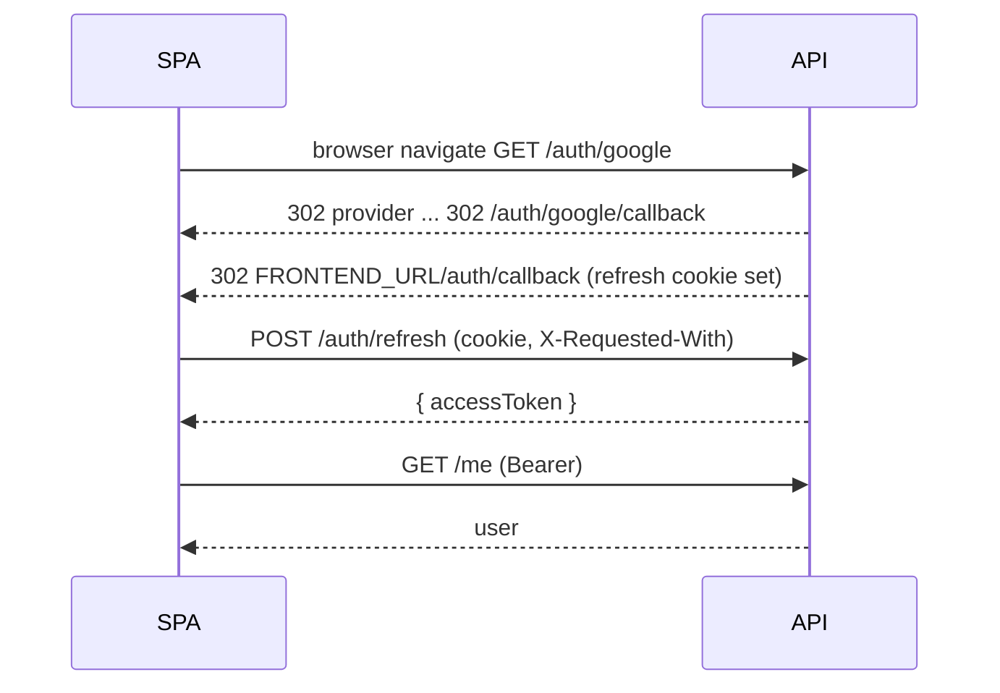

# API Contract

Base: `https://api.example.com`. JSON everywhere except redirects. SPA origin: `FRONTEND_URL`.

## Conventions

Error body (all non-2xx):

```json
{ "error": { "code": "invalid_state", "message": "Human readable text" } }
```

`code` is stable and machine readable, `message` can change.

Auth: `Authorization: Bearer <access_jwt>` where marked **JWT**. Refresh uses the `refresh_token` cookie.

State-changing cookie endpoints (`/auth/refresh`, `/auth/logout`) require header `X-Requested-With: fetch`, else 403 `csrf_header_missing`.

Providers in path: `google`, `facebook`, `telegram`. Unknown or not configured provider: 404 `provider_not_found`.

Request body limit: `BODY_LIMIT_BYTES` (default 10 KB). Larger: 413 `payload_too_large`. Malformed JSON: 400 `validation_failed`.

Unexpected server errors: 500 `internal_error`, generic message, details only in logs.

---

## GET /auth/:provider

Start login. Query: `mode=login` (default) or `mode=link` (see POST /auth/link).

Sets short-lived signed cookie `oauth_state` (holds state + PKCE verifier, 10 min, HttpOnly, Secure, SameSite=Lax, Path=/auth).

| Status | Meaning |
|---|---|
| 302 | Redirect to provider authorize URL |
| 404 | `provider_not_found` |

## GET /auth/:provider/callback

Provider redirects here. Query: `code`, `state`, or `error`, `error_description`.

Steps: check `oauth_state` cookie vs `state`, exchange code with PKCE verifier, load profile, apply linking rules, create refresh family, set refresh cookie.

| Status | Meaning |
|---|---|
| 302 | To `FRONTEND_URL/auth/callback` (success) |
| 302 | To `FRONTEND_URL/auth/callback?error=<code>` (any failure, no JSON because this is a browser navigation) |

Error codes in the redirect: `access_denied`, `invalid_state`, `provider_error`, `email_conflict`, `identity_taken`.

SPA then calls `POST /auth/refresh` to get the access token.

## POST /auth/refresh

No body. Needs cookie and `X-Requested-With: fetch`.

200:

```json
{ "accessToken": "<jwt>", "expiresIn": 900 }
```

Rotates refresh cookie.

| Status | Code |
|---|---|
| 401 | `refresh_missing`, `refresh_invalid`, `refresh_expired`, `refresh_reused` (family revoked) |
| 403 | `csrf_header_missing` |

On any 401 the SPA must clear its state and send the user to login.

## POST /auth/logout

Needs cookie and `X-Requested-With: fetch`. Revokes the family, clears cookie.

204 always (idempotent, even with missing or invalid cookie).

## GET /me  **JWT**

200:

```json
{
  "id": "uuid",
  "name": "Ali Valiyev",
  "email": "ali@gmail.com",
  "emailVerified": true,
  "avatarUrl": "https://...",
  "providers": ["google", "telegram"],
  "createdAt": "2026-11-21T09:00:00Z"
}
```

| Status | Code |
|---|---|
| 401 | `token_missing`, `token_invalid`, `token_expired` |

SPA: on `token_expired` call `/auth/refresh` once, retry, else login.

## POST /auth/link/:provider  **JWT**

Attach another provider to the current user.

- all providers (google, facebook, telegram): SPA first calls this to get a URL, then navigates the browser.
  Reason: a browser navigation cannot send the Bearer header.

200:

```json
{ "url": "https://accounts.google.com/o/oauth2/v2/auth?..." }
```

Server stores the user id inside the signed `oauth_state` cookie (mode=link). Callback then attaches the identity instead of logging in, and redirects to `FRONTEND_URL/settings/accounts?linked=google` (or `?error=...`).

| Status | Code |
|---|---|
| 404 | `provider_not_found` |
| 409 | `already_linked` (this user already has that provider) |
| 409 | `identity_taken` (reported in the callback redirect: that provider account belongs to another user) |

## DELETE /auth/link/:provider  **JWT**

204 on success.

| Status | Code |
|---|---|
| 404 | `not_linked` |
| 409 | `last_identity` (cannot remove the only login method) |

## GET /health

200 `{ "status": "ok" }`. No auth, no DB call (liveness). Used by deploy.

---

## Rate limits

| Route | Limit |
|---|---|
| `/auth/*` | 20 req/min per IP |
| `/auth/refresh` | 10 req/min per IP |

429 `rate_limited` with `Retry-After`.

## CORS

Allow origin: `FRONTEND_URL` only. `credentials: true`. Allowed headers: `Authorization, Content-Type, X-Requested-With`. No wildcard.

## SPA login sequence (summary)



## Open points

1. Linking via `POST /auth/link/:provider` returning a URL (needed because navigation cannot carry Bearer). Alternative is a one-time link token in the query string. URL approach chosen: simpler and no token in URL.
2. Account deletion endpoint is out of scope for this task.
