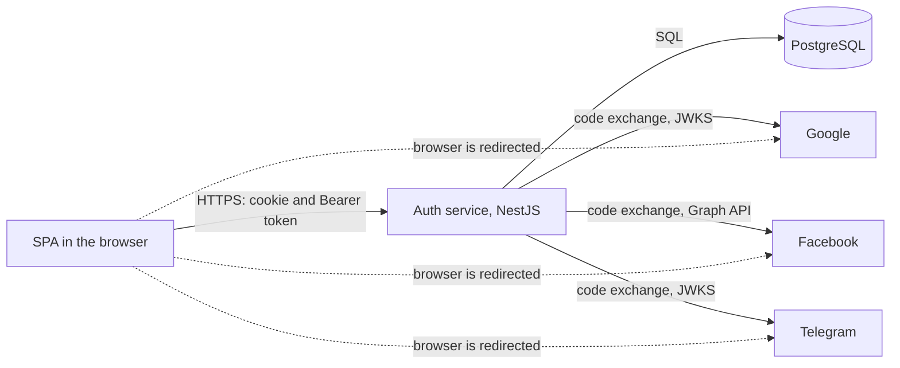
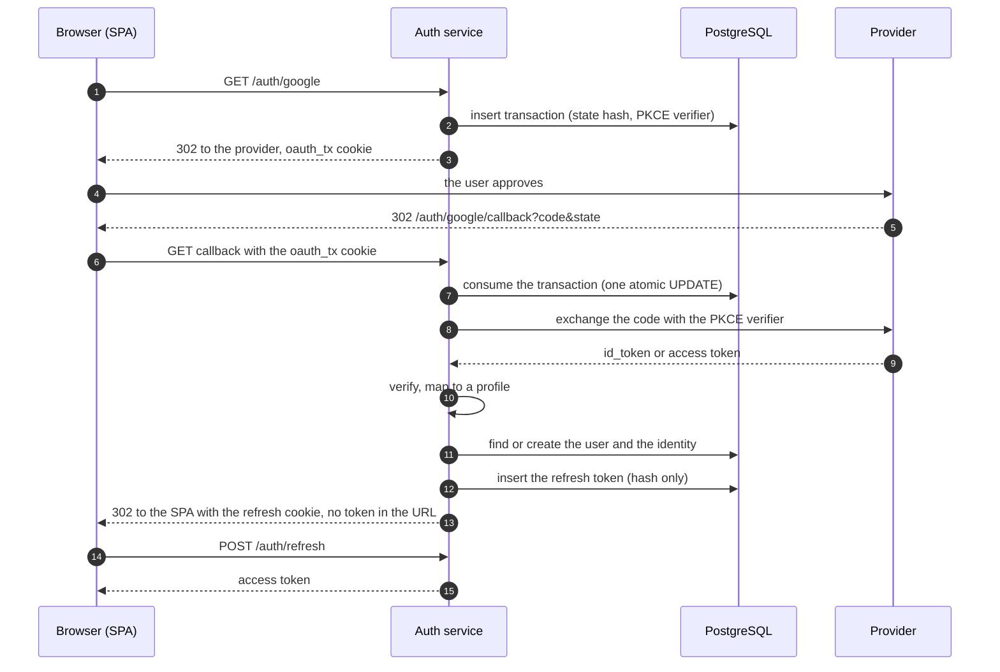
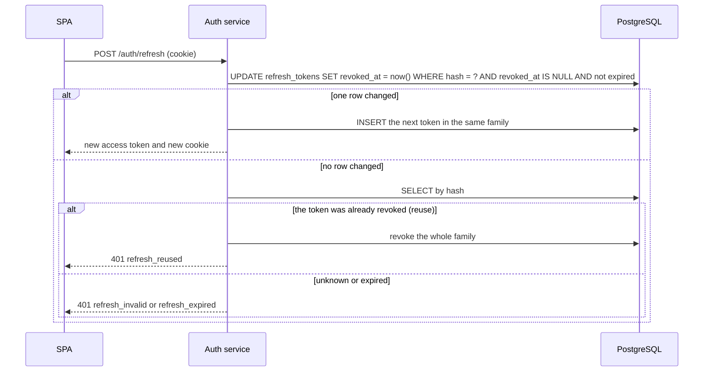
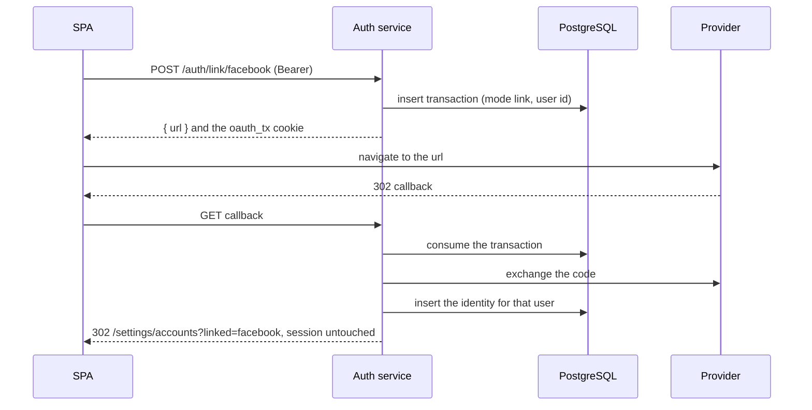

# Architecture

How the service is built and why. The database is described in [DATABASE.md](DATABASE.md), the threats in [SECURITY.md](SECURITY.md), and the tests in [TESTING.md](TESTING.md).

## The problem

The ticket: add OAuth login with Google, Facebook and Telegram, about four hours of work, in NestJS or Go. The team will move the service to Go later, so the design has to survive a rewrite.

| | |
|---|---|
| In scope | sign in and sign up with the three providers, sessions, `/me`, refresh, logout |
| Added on my own initiative | explicit account linking and unlinking (the ticket did not ask for it) |
| Out of scope | password login, roles, account deletion or merging, admin tools, cleanup jobs |

Assumptions that shaped the design, and what happened to each:

| Assumption | Outcome |
|---|---|
| The SPA and the API are on one site (subdomains of one domain) | Kept and confirmed. The cookie settings depend on it |
| There is no existing users table | Confirmed. The service owns `users` |
| I create the provider apps myself | Confirmed. All three apps exist and were used with real accounts |
| Telegram is "OAuth like the others" | Wrong. Its old login widget is archived and uses a different scheme. I switched to its OpenID Connect flow after reading the current documentation |
| One person can be recognised across providers by email | Rejected. Only Google proves an email. Matching on the others lets an attacker take over an account (see [SECURITY.md](SECURITY.md)) |

## System context



## Components

| Component | File | Responsibility |
|---|---|---|
| `AuthController` | `src/auth/auth.controller.ts` | The HTTP surface. Callbacks always answer with a redirect |
| `ProviderRegistry` | `src/auth/providers/provider.registry.ts` | Builds the adapters whose credentials are set. A provider without credentials does not exist |
| `GoogleProvider`, `TelegramProvider` | `src/auth/providers/` | OpenID Connect code flow with PKCE, `id_token` verified against the provider's keys |
| `FacebookProvider` | `src/auth/providers/facebook.provider.ts` | OAuth code flow with PKCE, then the Graph API, every call signed with `appsecret_proof` |
| `oidc.ts` | `src/auth/providers/oidc.ts` | Token request, `id_token` checks, and the key loader shared by Google and Telegram |
| `OAuthTransactionService` | `src/auth/oauth/` | One row per started flow: hashed `state`, PKCE verifier, mode, single use |
| `IdentityService` | `src/auth/identity/` | Find or create a user, link, unlink. The only place that decides who an account belongs to |
| `TokenService` | `src/auth/tokens/` | Access JWT and refresh token rotation |
| `CookieService`, guards | `src/auth/` | Cookies written in one place with identical set and clear options, CSRF and bearer checks |
| `UsersService` | `src/users/` | `/me` |
| `AllExceptionsFilter` | `src/common/` | Every error leaves as `{ "error": { "code", "message" } }` |
| `env.ts` | `src/config/` | Validates all configuration at startup and names every bad variable without printing its value |

A new provider is one adapter that implements `OAuthProvider` plus one line in the registry. `AuthController` and `IdentityService` know nothing about individual providers.

## Flows

### Login



The SPA never receives a token in a URL. After the redirect it calls `/auth/refresh`, and the httpOnly cookie that the browser sends automatically turns into an access token held in memory.

### Refresh rotation



The conditional `UPDATE` is the whole concurrency story: of two requests carrying the same token, the database lets exactly one change the row. The loser sees a revoked token, which is treated as theft and kills the family. A test fires 100 parallel refreshes of one token and requires exactly one success.

### Linking another provider



A browser navigation cannot carry an `Authorization` header, which is why linking starts with a `fetch` that returns the provider URL instead of being a plain redirect. The unique indexes decide conflicts: an account that already belongs to another user is refused with `identity_taken`.

## Session model

| | Access token | Refresh token |
|---|---|---|
| Form | HS256 JWT with `sub`, `iss`, `aud`, `iat`, `exp` only | 32 random bytes, opaque |
| Lifetime | 15 minutes | 30 days, renewed on every rotation |
| Where it lives | the SPA's memory | httpOnly, host-only, `SameSite=Lax` cookie on path `/auth` |
| Stored on the server | nothing | SHA-256 hash only |
| Revocable | no, it expires quickly | yes, by family |

The access token carries no email or roles on purpose: profile data comes from `/me`, so nothing in the token can go stale.

## Decisions

Each row is a choice where there was a real alternative.

| # | Decision | Alternatives considered | Why | Cost |
|---|---|---|---|---|
| 1 | NestJS, Prisma, PostgreSQL | Go (the team's target) | I know NestJS, so the four hours go into getting auth right instead of learning a language. The contract (endpoints, schema, token rules) is written so it ports | The code is rewritten later |
| 2 | Own `OAuthProvider` interface and one adapter per provider | Passport strategies | Passport hides the flow in decorators and does not port to Go. Adapters are small and testable with fakes | I wrote the three flows myself |
| 3 | `users` plus `oauth_identities`, keyed by `(provider, provider_user_id)` | One users table with a column per provider; matching by email | A person can have several providers and the key is the one thing a provider guarantees is stable | One more join |
| 4 | Never match accounts by email | Auto-link on equal email | Facebook and Telegram do not prove an email. Matching on it allows pre-registration takeover | A person who signed in with two providers separately has two profiles, and linking is explicit |
| 5 | Short access JWT plus rotating refresh token | Server sessions in Redis; one long-lived JWT | No session store to run, and a stolen refresh token is detected on its next use | Rotation needs the SPA to send refresh calls one at a time |
| 6 | Refresh tokens stored as SHA-256, rotated with one conditional `UPDATE`, reuse revokes the family | Bcrypt; a grace window for two tabs | The tokens are 256 bits of randomness, so a fast hash is correct. The grace window cannot work with hash-only storage | Two tabs refreshing at once log the user out |
| 7 | OAuth `state` and the PKCE verifier in a database table, consumed atomically | A signed cookie; Redis | A signed cookie cannot be made single use. The database is already there | One small table that is never cleaned up |
| 8 | PKCE (S256) on every provider | `state` alone | The code is useless without the verifier, even if it leaks | None |
| 9 | Telegram through OpenID Connect | The Login Widget with the HMAC hash check | The widget is archived. OIDC is the same shape as Google | Telegram only accepts https redirect URIs |
| 10 | `jose` for JWTs and JWKS | `@nestjs/jwt` | One library for signing our token and for checking provider tokens against their JWKS, with the algorithm pinned | Pinned to v5, newer majors are ESM-only |
| 11 | Linking is explicit, unlink locks the user row | Merging profiles | Merging needs both sides to consent and moves data. Locking stops two concurrent unlinks from removing every sign-in method | No merge, documented as a limit |
| 12 | Cookies host-only, `Lax`, path `/auth`, plus a custom header and an `Origin` check on refresh and logout | `SameSite=None`; tokens in the response body | The SPA and API share a site, so the strictest cookie works. The header forces a CORS preflight that a cross-site form cannot satisfy | Breaks if the two ever move to different sites |
| 13 | Callbacks always redirect, with an error code from a fixed list | JSON errors | A callback is a browser navigation, not an API call. Provider messages never reach a URL | The SPA needs a callback page |
| 14 | Environment validated at startup with `zod`, providers optional | Reading `process.env` where needed | The service refuses to start with a bad value, naming it, and runs with only some providers configured | None |
| 15 | Tests against real PostgreSQL with fake providers | Mocking Prisma | The guarantees that matter (atomic update, unique indexes, row locks) are database behaviour that a mock cannot show | Slower tests, a test database is needed |
| 16 | Logs carry no headers, cookies or query strings | Default request logging | Tokens, the OAuth `code` and `state` all travel in those places | Less detail per request |

## Layout

```
prisma/schema.prisma        schema and migrations (the source of truth)
src/config                  environment validation
src/auth/providers          adapters and the shared OIDC helpers
src/auth/tokens             access and refresh tokens
src/auth/oauth              state and PKCE transactions
src/auth/identity           find or create, link, unlink
src/auth                    controller, guards, cookies
src/users                   /me
src/common                  errors, crypto helpers
test, scripts               test setup, dev SPA, load test
```

## For the Go rewrite

What has to survive is the contract, not the NestJS structure.

- The endpoint table in the README and the OpenAPI document at `/docs`.
- The schema in [DATABASE.md](DATABASE.md), including the constraint names.
- The token rules: what the two tokens contain, the rotation rule, family revocation on reuse.
- The account rule: match on `(provider, provider_user_id)` only.
- The redirect and error codes.

NestJS decorators, the Prisma client and the TypeScript interfaces are implementation details.
