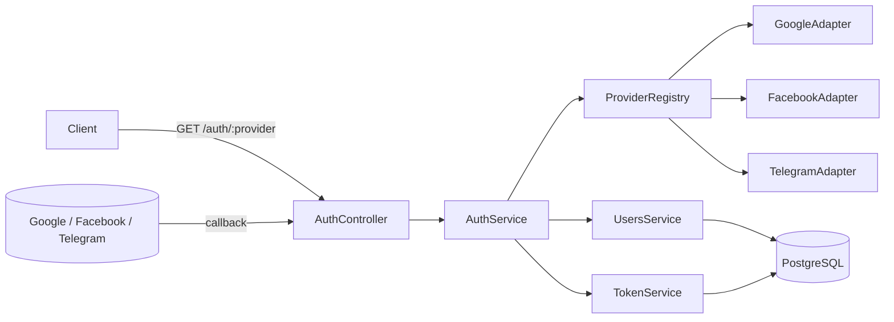
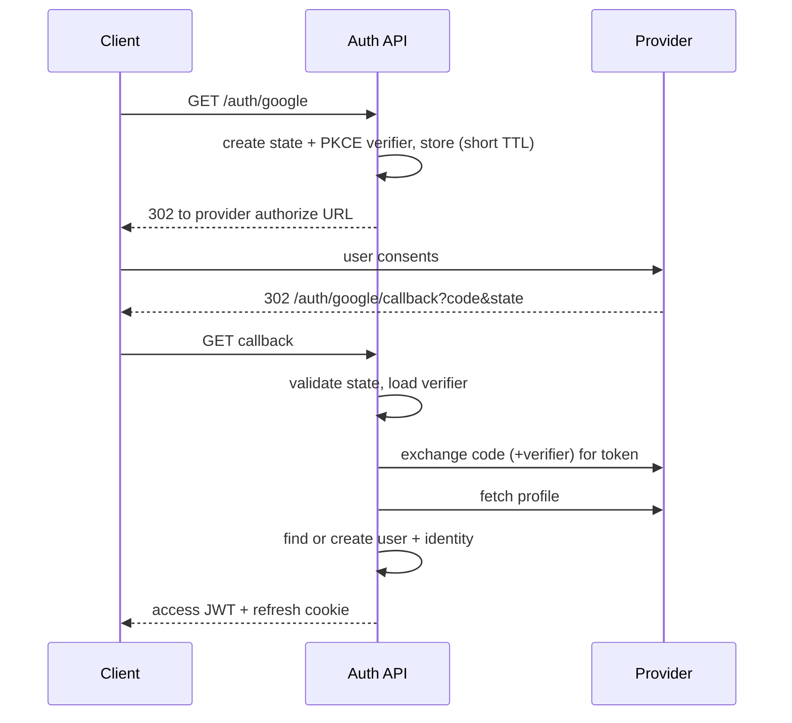
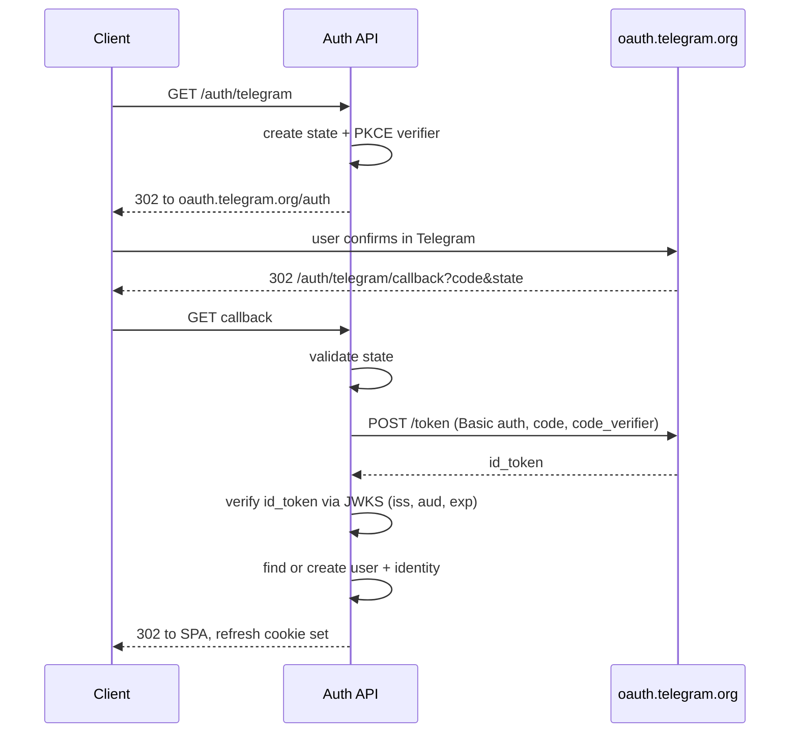

# OAuth Service: Design

Status: draft. Stack: NestJS, PostgreSQL, Prisma. Providers: Google, Telegram, Facebook.

## 1. Decisions (ADR summary)

| # | Decision | Why |
|---|----------|-----|
| 1 | Scope: login/signup + account linking | Full user story, linking needed for Telegram/Facebook without verified email |
| 2 | JWT access (short) + refresh token (httpOnly cookie, rotated, hashed in DB) | Stateless, easy to port to Go |
| 3 | `users` + `oauth_identities`; auto-link by email only if provider guarantees verified email (Google) | Prevents account takeover |
| 4 | Own `OAuthProvider` interface + one adapter per provider, no Passport | Less framework magic, portable to Go, new provider = one file |
| 5 | Credentials via `.env`, `.env.example` committed, secrets never | Standard, safe |

Non-goals: password login, more providers, admin UI, RBAC.

## 0. V1 scope and changes (overrides anything below that contradicts it)

Result of three independent reviews plus the ticket check. Where this section and later sections disagree, this section wins. Other docs are brought in line when the code and README are written.

**In scope:** login/signup with Google, Facebook, Telegram. `/me`, refresh, logout. Explicit account linking (`POST /auth/link/:provider`) and unlink (`DELETE /auth/link/:provider`), built last, after the core works (cut line: if not done by 2:30 into the 3 h, defer and say so in README). Not required by the ticket, added deliberately.

**Out of scope (listed in README as next steps):** refresh grace window, 90-day family cap, cleanup job, `Clock` service, audit-event taxonomy, standalone STRIDE work, rate-limit tests, 80-case test matrix.

**Decisions**

1. **Identity key is `(provider, provider_user_id)`. No auto-link by email, ever.** Only Google gives a verified email, so email-linking would never merge different providers, and linking onto an unverified row enables pre-account takeover. Linking happens only explicitly: a logged-in user attaches another provider.
2. **`users.email` is informational: set only when the provider verified it (Google), non-unique.** Raw provider email lives in `oauth_identities.email`. Drop `users.email_verified`. Email is trimmed and lowercased by one function.
3. **State lives in the DB.** Table `oauth_transactions(id, state_hash, code_verifier, provider, mode, user_id, expires_at, consumed_at)`. `mode` is `login` or `link`, `user_id` is set only for `link`. Cookie `oauth_tx` carries only the random id. Callback checks cookie id, `state`, provider, then consumes atomically: `UPDATE ... SET consumed_at=now() WHERE id=$1 AND consumed_at IS NULL AND expires_at>now() RETURNING *`. Login starts at `GET /auth/:provider`, link starts at `POST /auth/link/:provider` (JWT) which creates the transaction with `mode=link` and returns the provider URL. `GET /auth/:provider` never accepts `mode`.
3a. **Linking rules.** On a `link` callback: do not issue or replace refresh cookies. Verify the transaction's `user_id` still exists. Identity already owned by another user: redirect with `error=identity_taken`. User already has that provider: `error=already_linked`. Success: redirect to `FRONTEND_URL/settings/accounts?linked=<provider>`.
3b. **Unlink.** In one transaction lock the user row (`SELECT ... FOR UPDATE`), count identities, refuse with `last_identity` if only one, else delete. Two concurrent unlinks cannot leave zero methods.
4. **Refresh rotation is atomic:** `UPDATE refresh_tokens SET revoked_at=now() WHERE token_hash=$1 AND revoked_at IS NULL AND expires_at>now() RETURNING *`. Zero rows means invalid or reuse. Reuse of a revoked token revokes the whole `family_id`. No grace window, no `replaced_by`, no family age cap. SPA serializes refresh calls.
5. **Concurrent first login:** user + identity created in one `prisma.$transaction`. On `P2002` for `(provider, provider_user_id)` re-query the identity and log in its owner. Never create a second user. No external HTTP inside a transaction. In the link flow, map the constraint name: `uq_identity_provider_subject` becomes `identity_taken`, `uq_identity_user_provider` becomes `already_linked`.
6. **Cookies:** host-only (no `COOKIE_DOMAIN`). `COOKIE_SAME_SITE` env (`lax` default, `none` only with HTTPS tunnel testing). `clearCookie` uses exactly the options used to set. SPA and API are same-site (decided).
7. **Callback errors are always 302** to `FRONTEND_URL/auth/callback?error=<code>`, code from a fixed allowlist. Provider error text never reaches the URL.
8. **Telegram:** `jose` + remote JWKS (timeout, no trust in `jku`), algorithm pinned to RS256, check `iss`, `aud`, `exp` (must be in the future), `nbf`, non-empty `sub`, 30 s clock tolerance. No `nonce` (not documented for the manual flow), rely on `state` + PKCE. Spike the localhost redirect only after Google works.
9. **Facebook:** pinned Graph API version, `appsecret_proof` on Graph calls, try PKCE, drop it with a logged warning if Meta rejects it.
10. **Name fallback:** `name`, else `preferred_username`, else `"User"`. Truncate to column length, accept only `https` avatar URLs.
11. **Prisma schema is the source of truth** (`schema.dbml` is an illustration). Snake_case via `@@map`/`@map`.
12. **Tooling:** `prisma migrate dev` with committed migrations, `zod` env validation, `pino` with `redact`. Rate limit: `@nestjs/throttler` global, no tests. Existing project lint/format config is used when one exists.

**Tests (about 12-15):** email normalization and no-link decision, token service (JWT verify cases, refresh hash), atomic rotation and reuse revokes family, state consume once and mismatch, Telegram `id_token` good/bad signature, `iss`, `aud`, expired, `P2002` race, callback happy path with fake provider, callback error redirects, refresh without `X-Requested-With`. Linking adds: link attaches identity without touching the refresh cookie, `identity_taken`, `last_identity` on unlink.

**Order (3 h):** schema + config, token + state + user services with unit tests, Google end to end (manual real login), Facebook, Telegram, linking and unlink, remaining integration tests, README with trade-offs. If Telegram stalls on external setup, cap it at 10 minutes and move on to linking.

## 2. Component view



## 3. Flow: Google / Facebook (authorization code + PKCE; Telegram is the same, see 4)



## 4. Flow: Telegram (OpenID Connect)

Telegram's current login is standard OIDC (authorization code + PKCE S256). The legacy Login Widget is archived and not used. Same redirect flow as section 3, differences are only in the adapter:

- Endpoints: `https://oauth.telegram.org/auth`, `/token`. JWKS: `/.well-known/jwks.json`. Issuer: `https://oauth.telegram.org`.
- Token request uses HTTP Basic auth (`client_id:client_secret`).
- No userinfo endpoint. Profile comes from the `id_token`: `sub`, `name`, `preferred_username`, `picture` (scope `openid profile`). We do not request `phone`.
- No email claim, so Telegram identities are never auto-linked by email.
- `id_token` validation: signature via JWKS (library `jose`), algorithm pinned to RS256, `iss` equals Telegram issuer, `aud` equals our client id, `exp` not passed.
- `provider_user_id` = `sub`.



## 5. Account linking rules

- Identity found by `(provider, provider_user_id)`: log in that user.
- Not found, provider email verified (Google only): link to existing user with same email, else create user.
- Not found, no verified email (Telegram, Facebook): create new user. Never auto-link by email.
- Explicit linking: authenticated user calls `POST /auth/link/:provider`, identity attached to current user. If identity belongs to another user: 409.
- Unlink: refuse if it is the user's last identity.

## 6. Data model

```dbml
Table users {
  id uuid [pk]
  email varchar [null, unique]
  email_verified boolean [default: false]
  name varchar
  avatar_url varchar [null]
  created_at timestamptz
  updated_at timestamptz
}

Table oauth_identities {
  id uuid [pk]
  user_id uuid [ref: > users.id]
  provider varchar   // google | facebook | telegram
  provider_user_id varchar
  email varchar [null]
  created_at timestamptz
  indexes { (provider, provider_user_id) [unique] }
}

Table refresh_tokens {
  id uuid [pk]
  user_id uuid [ref: > users.id]
  token_hash varchar [unique]
  family_id uuid     // rotation family, reuse detection
  expires_at timestamptz
  revoked_at timestamptz [null]
  created_at timestamptz
}
```

Provider access tokens are not stored (login only, no API calls on behalf of user).

## 7. Provider interface

```ts
export interface OAuthProfile {
  providerUserId: string;
  email?: string;
  emailVerified: boolean;
  name: string;
  avatarUrl?: string;
}

export interface OAuthProvider {
  readonly name: 'google' | 'facebook' | 'telegram';
  getAuthorizationUrl(state: string, codeChallenge: string): string;
  /** Exchange code (+ PKCE verifier), validate, return normalized profile. */
  authenticate(input: { code: string; codeVerifier: string }): Promise<OAuthProfile>;
}
```

`AuthService` only knows this interface. Adding a provider = one adapter + register in `ProviderRegistry`.

## 8. Endpoints

| Method | Path | Auth | Purpose |
|--------|------|------|---------|
| GET | `/auth/:provider` | no | Start redirect flow (google, facebook, telegram) |
| GET | `/auth/:provider/callback` | no | Finish redirect flow |
| POST | `/auth/link/:provider` | JWT | Attach identity to current user |
| DELETE | `/auth/link/:provider` | JWT | Detach identity |
| POST | `/auth/refresh` | cookie | Rotate refresh, new access |
| POST | `/auth/logout` | cookie | Revoke refresh family |
| GET | `/me` | JWT | Current user + linked providers |

## 9. Error cases

- `state` missing or mismatch: 400, no login.
- User denied consent (`error=access_denied`): 401 with clear code.
- Telegram `id_token` invalid (bad signature, `iss`, `aud`, expired): redirect with `error=provider_error`.
- Provider returned no email and none needed: allowed, user.email null.
- Identity already linked to another user: 409.
- Refresh token reused after rotation: revoke whole family, 401.

## 10. Security checklist

- `state` random, single use, TTL 10 min, bound to browser (cookie).
- PKCE (S256) for Google and Facebook.
- `id_token` verified against provider JWKS with pinned algorithm, `iss`, `aud`, `exp`.
- Refresh token stored hashed, httpOnly + Secure + SameSite=Lax cookie.
- Redirect URIs fixed from config, never from request.
- Secrets only in env. `.env` in `.gitignore`.
- Rate limit `/auth/*`.
- Body size limit, validation on every DTO.
- Timeouts on all outgoing provider HTTP calls.
- Logger redacts `authorization`, `cookie`, `set-cookie`, `client_secret`, `code`, `state`, `hash`.

Full analysis: [THREAT_MODEL.md](THREAT_MODEL.md).

## 10a. Audit log

Structured JSON, one line per event. Fields: `event`, `userId`, `provider`, `outcome`, `requestId`, `ip`, `userAgent`, `ts`. Never tokens, cookies, `code`, `state`, secrets.

Events: `login.success`, `login.failure`, `identity.linked`, `identity.unlinked`, `refresh.rotated`, `refresh.reuse_detected`, `logout`.

## 10b. Time

All expiry logic (state TTL, `id_token` `exp`, refresh TTL, grace window) goes through an injected `Clock` service, not `Date.now()`. Makes tests deterministic and ports cleanly to Go.

## 11. Folder structure

```
src/
  main.ts
  app.module.ts
  config/            env validation
  prisma/            PrismaService
  common/            clock, logger + redaction, exception filter (stable error format)
  auth/
    auth.controller.ts
    auth.service.ts
    state.store.ts   state + PKCE, TTL
    providers/
      oauth-provider.interface.ts
      provider.registry.ts
      google.provider.ts
      facebook.provider.ts
      telegram.provider.ts
    tokens/
      token.service.ts
  users/
    users.service.ts
    users.controller.ts   (/me)
prisma/schema.prisma
docs/DESIGN.md
test/
```

## 11a. Related documents

- [schema.dbml](schema.dbml): database schema (view with a DBML extension)
- [TOKENS.md](TOKENS.md): JWT, refresh rotation, cookies, CSRF
- [API.md](API.md): endpoint contract
- [CONFIG.md](CONFIG.md): env variables, provider setup
- [THREAT_MODEL.md](THREAT_MODEL.md): STRIDE analysis
- [TEST_PLAN.md](TEST_PLAN.md): test strategy and cases

## 12. Open questions

- Where does the client live (SPA, mobile)? Affects cookie vs body for tokens and callback redirect target.
- Is there an existing users table elsewhere to integrate with later?
- `state` storage: in-memory is enough for one instance, Redis if scaled. Start with signed cookie.
