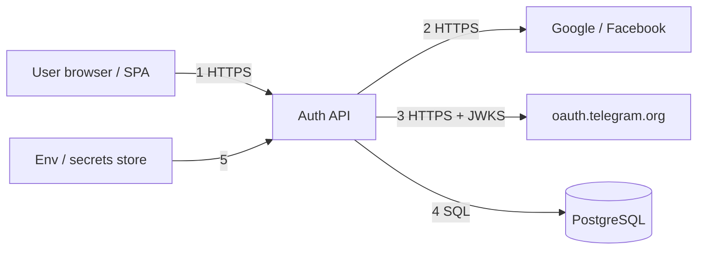

# Threat Model

Method: STRIDE per trust boundary. Scope: this service (API + DB) and its interaction with the SPA and the three providers.

## 1. Assets

| Asset | Why it matters |
|---|---|
| User accounts (`users`, `oauth_identities`) | Takeover means access to everything the account owns downstream |
| Refresh tokens | Long-lived session, 30 days |
| Access JWT | Short-lived session, 15 min |
| `JWT_SECRET` | Anyone holding it can mint valid tokens for any user |
| Provider secrets (`GOOGLE_CLIENT_SECRET`, `FACEBOOK_APP_SECRET`, `TELEGRAM_CLIENT_SECRET`) | Impersonate our app, exchange stolen codes |
| `COOKIE_SECRET` | Forge the `oauth_state` cookie |
| Email, name, avatar (PII) | Privacy, GDPR-style obligations |

## 2. Trust boundaries

1. Browser to API: fully untrusted input.
2. API to provider: trusted for identity claims only over TLS, responses still validated.
3. Telegram: `id_token` is untrusted until signature (JWKS), `iss`, `aud` and `exp` are verified.
4. API to DB: trusted network, still parameterized queries.
5. Secrets: trusted store, must not leak into logs or repo.

## 3. Threats and mitigations

Legend: status is **Designed** (in docs), **Code** (needs a test), **Ops** (deployment concern).

### Spoofing

| # | Threat | Mitigation | Status |
|---|---|---|---|
| S1 | Forged or substituted Telegram `id_token` | Verify signature with Telegram JWKS, pin RS256, check `iss`, `aud` (our client id), `exp` | Designed, Code test |
| S2 | Replay of a captured authorization code or token | Code is single use, bound to PKCE verifier and `state`. `id_token` is fetched server to server, never accepted from the browser | Designed, Code test |
| S3 | Attacker sends their own `code` to the callback (login CSRF, victim gets logged into attacker account) | `state` bound to browser through signed cookie, single use | Designed |
| S4 | Authorization code interception | PKCE S256 (Google, Facebook, Telegram), code only valid with verifier | Designed, Facebook unconfirmed |
| S5 | Account takeover through email collision: attacker creates a Facebook/Telegram account with victim's email | Auto-link only for Google with `email_verified=true`. Never for Facebook or Telegram | Designed, Code test |
| S6 | Forged JWT (`alg=none`, algorithm confusion) | Pin algorithm, reject others, verify `iss` and `aud` | Designed |
| S7 | Phishing clone of the login page | Out of scope for the service. Redirect URIs fixed in provider consoles | Ops |

### Tampering

| # | Threat | Mitigation | Status |
|---|--------|------------|--------|
| T1 | Modified `state` cookie | Signed with `COOKIE_SECRET`, verify before use | Designed |
| T2 | Open redirect via callback parameter | Redirect targets built only from `FRONTEND_URL`, never from request input | Designed |
| T3 | Link flow hijack: attacker starts `mode=link` for the victim's session | `POST /auth/link/:provider` requires a valid JWT, user id sealed in the signed state cookie | Designed |
| T4 | SQL injection | Prisma parameterized queries, no raw SQL with interpolation | Code |
| T5 | Mass assignment on profile data | Explicit DTO allowlists, never spread provider response into DB | Code |

### Repudiation

| # | Threat | Mitigation | Status |
|---|--------|------------|--------|
| R1 | "I did not log in" with no evidence | Structured audit log: login, link, unlink, refresh reuse, with user id, provider, IP, user agent, timestamp. No tokens in logs | Add to design, Code |
| R2 | Admin or dev tampering with logs | Out of scope for this task | Ops |

### Information disclosure

| # | Threat | Mitigation | Status |
|---|--------|------------|--------|
| I1 | XSS steals refresh token | httpOnly cookie. Access token in memory only, never `localStorage` | Designed |
| I2 | DB leak exposes refresh tokens | Only SHA-256 hashes stored | Designed |
| I3 | Tokens in URL (browser history, referer, logs) | Callback redirect carries no tokens, SPA calls `/auth/refresh` | Designed |
| I4 | Secrets leaked via repo or logs | `.env` gitignored, config validated at boot, logger redacts `authorization`, `cookie`, `set-cookie`, `client_secret`, `code` | Code |
| I5 | User enumeration | Not applicable, no password or email lookup endpoint. Errors for link conflicts only reveal state to the authenticated user | Designed |
| I6 | Verbose errors leak internals | Global exception filter returns the stable error format, stack only in logs | Code |
| I7 | Provider tokens stored unnecessarily | Not stored at all (login only) | Designed |

### Denial of service

| # | Threat | Mitigation | Status |
|---|--------|------------|--------|
| D1 | Brute force or flooding of auth endpoints | Rate limit per IP: 20/min `/auth/*`, 10/min telegram and refresh | Designed |
| D2 | Large request bodies | Body size limit (for example 10 KB), validation on every DTO | Code |
| D3 | Slow or down provider hangs requests | Timeouts (5 s) on all outgoing HTTP, no retries on code exchange | Code |
| D4 | Refresh table grows forever | Cleanup job removes rows expired for 7+ days | Designed |
| D5 | Attacker burns a victim's refresh family by replaying old tokens | Accepted risk: requires a stolen old token, and forces re-login (fail safe) | Accepted |

### Elevation of privilege

| # | Threat | Mitigation | Status |
|---|--------|------------|--------|
| E1 | Link a provider account that already belongs to another user, merging accounts | 409 `identity_taken`, unique index on `(provider, provider_user_id)` | Designed |
| E2 | Unlink last identity, locking user out or leaving orphan | 409 `last_identity` | Designed |
| E3 | Using refresh token of another family or user | Lookup by hash, user id comes from the row, not the request | Designed |
| E4 | Stale JWT after account deletion | Accepted: max 15 min. No roles in token, so nothing to escalate | Accepted |

## 4. CSRF specifics

- Refresh and logout are POST, need `X-Requested-With: fetch`, strict CORS allowlist, `SameSite=Lax`.
- Access token is sent via header, not cookie, so API endpoints are not CSRF-able.
- `GET /auth/:provider` and callback are GET but only start a flow or finish one bound to `state`.

## 5. Logging policy

Log (structured JSON): event, user id, provider, outcome, request id, IP, user agent.
Never log: tokens, cookies, `code`, `state`, `hash`, secrets, full provider profile.

## 6. Residual risks (accepted)

1. Stolen refresh token used before the owner: detected on the owner's next refresh (reuse), session killed. Window exists until then.
2. Facebook and Telegram users without verified email can end up with duplicate accounts if they also use Google. Fix is explicit linking, by design.
3. A compromised provider account means a compromised login here. Cannot be fixed at this layer.
4. HS256: one secret signs and verifies. A leak of `JWT_SECRET` needs rotation and invalidates all access tokens (15 min impact), refresh tokens survive.

## 7. Items to feed back into other docs

- DESIGN.md: add audit log events.
- API.md: add body size limit and 413 `payload_too_large`.
- CONFIG.md: add `LOG_LEVEL`, `HTTP_TIMEOUT_MS`, `BODY_LIMIT_BYTES`.
- `.gitignore`: `.env`, `*.dbdiagram`.
